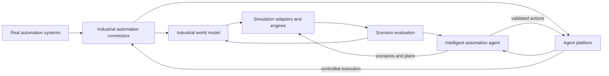

# Simulator Bot

**English | [简体中文](README.zh-CN.md)**

## Mission

Our purpose is to accelerate the deployment of industrial automation scenarios by building intelligent agents that learn from real-world operations and use simulation to improve automation.

## Product concept

The intelligent bot is the core product. Simulation is the foundation the bot uses to understand automation systems, explore future scenarios, and validate improvement ideas.

The bot's defining capability is learning how real operations correspond to their simulated models. It observes equipment, processes, events, and constraints; builds and updates a scenario model; tests possible futures in simulation; and uses the difference between predicted and observed results to improve its models and strategies. Validated improvements can then be brought back to real operations through a controlled process.

The simulation does not need to be a detailed 3D replica. It needs to describe the parts of reality that matter to a scenario well enough to predict behavior and compare decisions.

## System architecture

The feedback loop is:

**Observe reality → map it into a scenario model → simulate future cases → compare predictions with outcomes → improve the model and agent → apply validated improvements to real operations.**

## Planned engineering projects

These are proposed project boundaries. The connector layer is the first defined project; the other boundaries can evolve as implementation needs become clearer.

| Project | Responsibility |
| --- | --- |
| `industrial-automation-connectors` | Connect to PLC, MES, SCADA, robot, and other automation systems. Normalize telemetry, events, and available actions for upper layers. This layer does not own agent reasoning, runtime, or permissions. |
| `industrial-world-model` | Represent equipment, processes, states, relationships, and constraints in a versioned scenario model that can be calibrated against real operations. |
| `simulation-adapters` | Connect scenario models to simulation engines and provide a consistent way to define and run future scenarios. The initial approach can integrate existing engines. |
| `automation-agent` | Provide the core intelligence: understand a scenario, learn the mapping between reality and simulation, plan tasks, interpret simulation results, and improve strategies. |
| `automation-agent-platform` | Host and coordinate agents, tools, and workflows. Own runtime, permissions, execution controls, and audit records. |
| `scenario-evaluation` | Compare simulated predictions with real outcomes; manage test scenarios, metrics, regression checks, and model or agent evaluations. |

## Design principles

- **Reality first:** model the operational details that affect the target scenario, including constraints and failure cases.
- **Calibrated simulation:** update models from real data and track model versions, evidence, and uncertainty.
- **Future-oriented:** use the model to test alternative conditions and plans before changing real operations.
- **Measured learning:** evaluate agent and model changes against recorded scenarios and observed outcomes.
- **Controlled execution:** the agent platform governs permissions and the path from a validated simulation result to real-world action.

## Initial development loop

Start with one bounded automation scenario and one supported system integration. Capture its observable state and actions, build a useful scenario model, run future cases in simulation, compare predictions with observed results, and improve the mapping. Expand to additional equipment and scenarios as the loop proves reliable.
