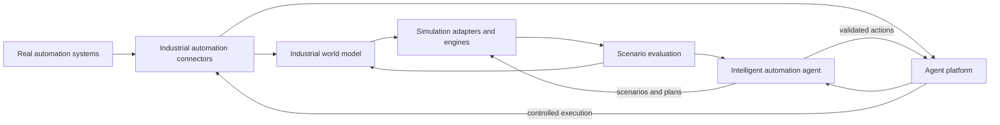

# Simulator Bot

**English | [简体中文](README.zh-CN.md)**

## Mission

We accelerate the deployment of industrial automation scenarios by building intelligent agents that learn from real-world operations and use simulation to improve automation.

## Product definition

The intelligent agent is the core product. Simulation is the agent's modeling and experimentation foundation. The agent connects real operations to a virtual model, uses that model to evaluate future scenarios, and applies validated results to improve automation.

The agent observes equipment, process flows, events, and operating constraints. It maps these observations to the simulation model, calibrates the model against real data, tests future scenarios, and compares simulated outcomes with actual results. It uses the measured differences to improve the model and its operating strategies.

Each simulation model represents the equipment states, process flows, relationships, constraints, and failure behavior required by its target scenario. Model validity is measured by how accurately it reproduces relevant real behavior and predicts scenario outcomes. Three-dimensional visualization is one way to present a model; it is not the model itself.

## System architecture

The operating loop is:

**Observe real operations → map them into the world model → simulate future scenarios → compare predictions with actual results → improve the model and agent → release validated improvements through the agent platform.**

## Engineering projects

The engineering program consists of six projects with defined responsibilities:

| Project | Responsibility |
| --- | --- |
| `industrial-automation-connectors` | Connect PLC, MES, SCADA, robots, and other automation systems. Normalize telemetry, events, and available actions for upper layers. This project does not own agent reasoning, runtime, or permissions. |
| `industrial-world-model` | Define and maintain the shared model of equipment, processes, states, relationships, and constraints. Calibrate scenario models against real operating data. |
| `simulation-adapters` | Connect world models to simulation engines through consistent interfaces for building and running future scenarios. |
| `automation-agent` | Implement the core intelligence: understand scenarios, learn the mapping between real operations and simulation, plan tasks, interpret simulation results, and improve strategies. |
| `automation-agent-platform` | Run and coordinate agents, tools, and workflows. Manage runtime, permissions, execution controls, and audit records. |
| `scenario-evaluation` | Compare simulated predictions with real outcomes. Maintain test scenarios, metrics, regression checks, and evaluations of models and agents. |

## Design commitments

- **Reality-to-simulation mapping:** represent the real equipment, processes, constraints, and behaviors that determine each target scenario.
- **Measured model calibration:** validate simulation outputs against real operating data and outcomes; record model versions and supporting evidence.
- **Future scenario testing:** evaluate alternative conditions and plans in simulation before releasing changes to real operations.
- **Evidence-based improvement:** use measured prediction errors and scenario results to update the model and agent.
- **Controlled execution:** route every real-world action through the agent platform's permissions, execution controls, and audit records.

## Implementation sequence

1. Connect one automation system through `industrial-automation-connectors` and normalize its states, events, and available operations.
2. Build an `industrial-world-model` for one representative automation scenario, including its operating states, constraints, and process behavior.
3. Connect the model to a simulation engine through `simulation-adapters` and run defined future scenarios.
4. Implement the agent's reality-to-simulation mapping and compare its predictions with actual operating results.
5. Use evaluation results to calibrate the model and improve the agent; release validated changes through `automation-agent-platform`.
6. Extend the same interfaces and evaluation process to additional systems and scenarios.
