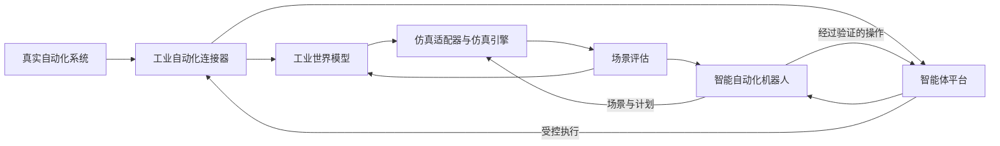

# Simulator Bot

**[English](README.md) | 简体中文**

## 宗旨

我们的宗旨是构建能够从真实工业运行中学习、并借助仿真改进自动化的智能机器人，加速工业自动化场景的落地。

## 产品理念

智能机器人是核心产品，仿真是机器人理解自动化系统、探索未来场景和验证改进想法的基础工具。

机器人的关键能力，是学习现实运行与仿真模型之间的对应关系。它观察设备、流程、事件和约束，建立并更新场景模型，在仿真中测试可能的未来，再根据预测结果与实际结果之间的差异，改进模型和策略。经过验证的改进，可以通过受控流程带回真实运行。

仿真不必一开始就成为高度精细的三维复刻。它需要把与目标场景相关的现实描述清楚，足以预测行为并比较不同决策。

## 系统架构

反馈闭环：

**观察现实 → 映射为场景模型 → 仿真未来场景 → 对照预测与实际结果 → 改进模型和机器人 → 将经过验证的改进应用于真实运行。**

## 规划中的工程项目

以下是建议的工程边界。目前已明确连接器层的职责；其他边界可随着实现需求逐步调整。

| 工程 | 职责 |
| --- | --- |
| `industrial-automation-connectors` | 连接 PLC、MES、SCADA、机器人及其他自动化系统；将遥测数据、事件和可用操作整理成上层可调用的接口。本层不负责机器人推理、运行时或权限。 |
| `industrial-world-model` | 以可版本化的场景模型描述设备、流程、状态、关系和约束，并支持根据真实运行校准模型。 |
| `simulation-adapters` | 将场景模型接入仿真引擎，提供统一方式来定义和运行未来场景。初期可以集成现有仿真引擎。 |
| `automation-agent` | 提供核心智能能力：理解场景、学习现实与仿真的映射、规划任务、解释仿真结果并改进策略。 |
| `automation-agent-platform` | 承载和协调机器人、工具与工作流；负责运行时、权限、执行控制和审计记录。 |
| `scenario-evaluation` | 对比仿真预测与真实结果，管理测试场景、指标、回归检查，以及模型和机器人的评估。 |

## 设计原则

- **以现实为准：** 优先描述影响目标场景的运行细节，包括约束和故障情况。
- **校准仿真：** 使用真实数据更新模型，并记录模型版本、依据和不确定性。
- **面向未来：** 在改变真实运行前，用模型测试不同条件和方案。
- **以评估驱动学习：** 使用记录的场景和实际结果评估模型与机器人的变化。
- **受控执行：** 由智能体平台管理权限，并控制经过仿真验证的结果如何进入真实操作。

## 初始开发闭环

从一个范围明确的自动化场景和一种系统集成开始：采集可观测状态与操作，建立有用的场景模型，在仿真中运行未来场景，对照预测与实际结果，再改进现实到仿真的映射。待闭环稳定后，再扩展设备和场景范围。
