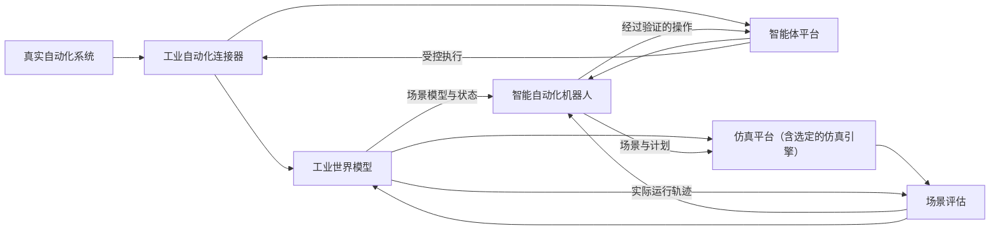

# Simulator Bot

**[English](README.md) | 简体中文**

## 宗旨

我们通过构建能够从真实工业运行中学习、并借助仿真改进自动化的智能机器人，加速工业自动化场景的落地。

## 产品定义

智能机器人是核心产品。仿真是机器人的建模与实验底座。机器人连接真实运行与虚拟模型，使用模型评估未来场景，并将经过验证的结果用于改进自动化。

连接器采集现场记录，工业世界模型把点位变化映射到设备动作和物料流转，重建状态并用实绩校准行为参数。机器人读取共享模型，围绕问题提出变更；仿真平台运行候选场景，场景评估对照预测与实际结果，机器人据此解释结果并提出改进。

同一模型可以描述单机、生产片区和全厂。设备模板定义动作与反馈，设备实例绑定现场点位，工艺路由、缓存、交接和共享资源描述设备间的影响。全厂层面通过工单与跨区流转连接各片区。以复现已知过程和预测场景结果的能力衡量模型有效性。

## 系统架构

系统运行闭环：

**观察真实运行 → 映射到世界模型 → 仿真未来场景 → 对照预测与实际结果 → 改进模型和机器人 → 通过智能体平台发布经过验证的改进。**

## 工程项目

工程体系由六个职责明确的项目组成：

| 工程 | 职责 |
| --- | --- |
| `industrial-automation-connectors` | 连接 PLC、MES、SCADA、机器人及其他自动化系统，将遥测数据、事件和可用操作整理成上层接口。本工程不负责机器人推理、运行时或权限。 |
| `industrial-world-model` | 定义并维护设备、流程、状态、关系和约束的共享模型；使用真实运行数据校准场景模型，并通过稳定接口供 Agent 和仿真平台读取。 |
| `simulation-platform` | 根据试点需要设计仿真方案，接入选定的仿真引擎，并用于构建和运行未来场景。具体引擎尚未确定；适配器是平台的一种实现组件。 |
| `automation-agent` | 通过世界模型接口读取场景状态、关系和约束；实现理解场景、学习真实运行与仿真之间的映射、规划任务、解释仿真结果并改进策略等核心智能能力。 |
| `automation-agent-platform` | 运行和协调机器人、工具及工作流；管理运行时、权限、执行控制和审计记录。 |
| `scenario-evaluation` | 对比仿真预测与实际结果，维护测试场景、指标、回归检查，并评估模型和机器人。 |

## 设计约定

- **现实到仿真的映射：** 描述决定目标场景的真实设备、流程、约束和行为。
- **基于测量校准模型：** 使用真实运行数据和结果验证仿真输出，并记录模型版本与依据。
- **仿真未来场景：** 在向真实运行发布变更前，先在仿真中评估不同条件和方案。
- **依据证据改进：** 使用测得的预测误差和场景结果更新模型与机器人。
- **受控执行：** 所有面向真实系统的操作都通过智能体平台的权限、执行控制和审计流程。

## 实施顺序

1. 通过 `industrial-automation-connectors` 接入一种自动化系统，并统一其状态、事件和可用操作。
2. 在 `industrial-world-model` 用一段真实班次日志回放两台相邻设备的一次交接，交付可追溯的工件轨迹和带版本的交接时刻快照，列出设备状态、在制品、资源占用和未知项。
3. 设计仿真方案并选择试点引擎，通过 `simulation-platform` 将模型接入仿真环境，运行定义好的未来场景。
4. 机器人提出场景与计划，评估工程对照仿真结果与实际运行轨迹，机器人据此解释差异。
5. 根据评估结果校准模型、改进机器人，并通过 `automation-agent-platform` 发布经过验证的变更。
6. 使用相同接口和评估流程扩展到更多系统与场景。
